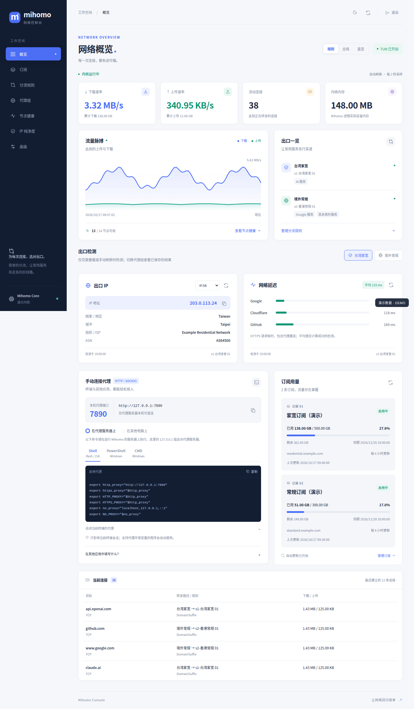
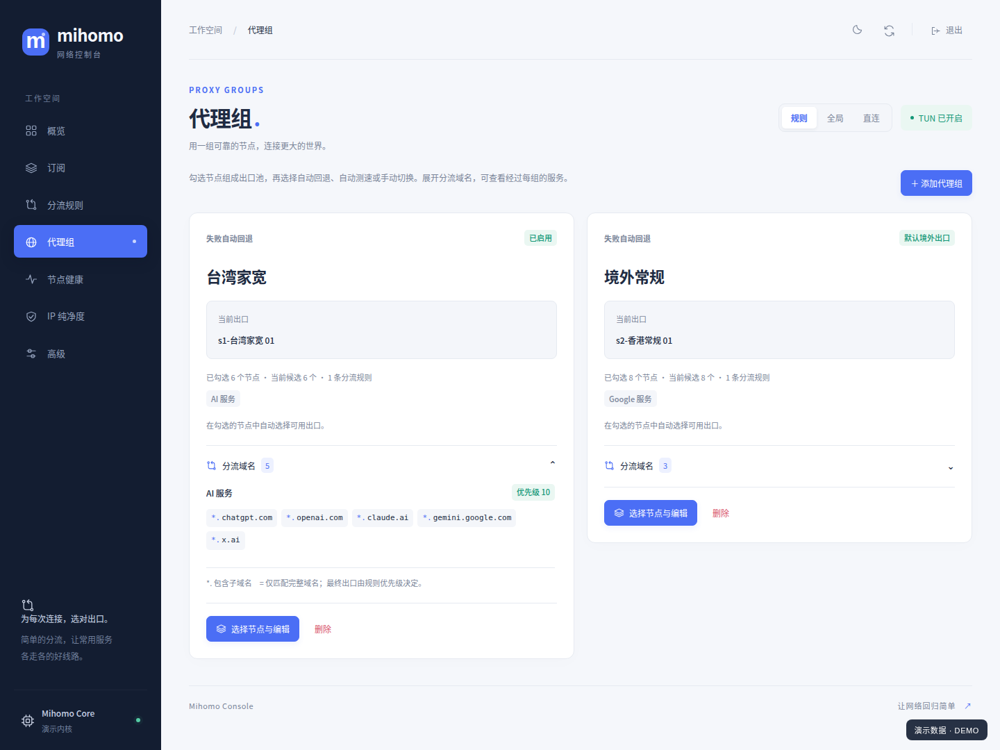
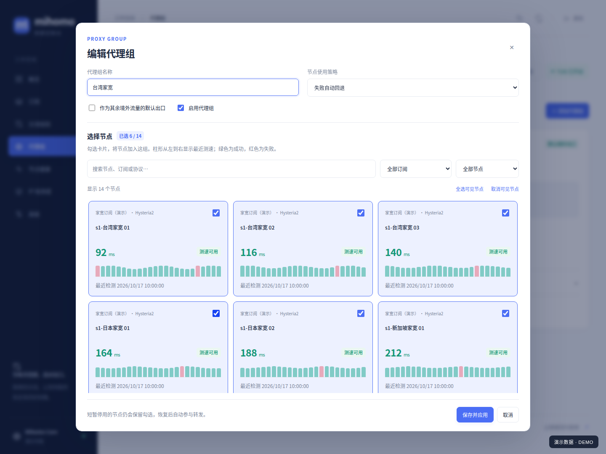
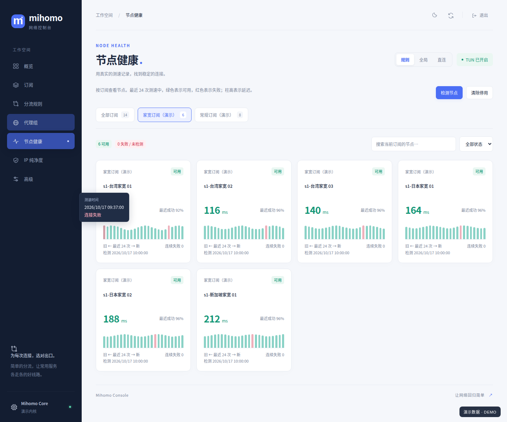
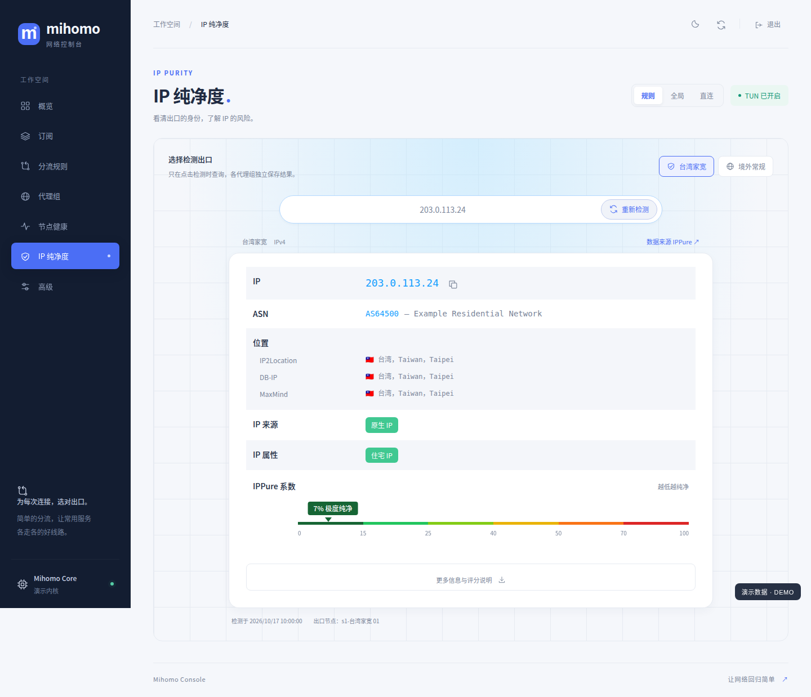
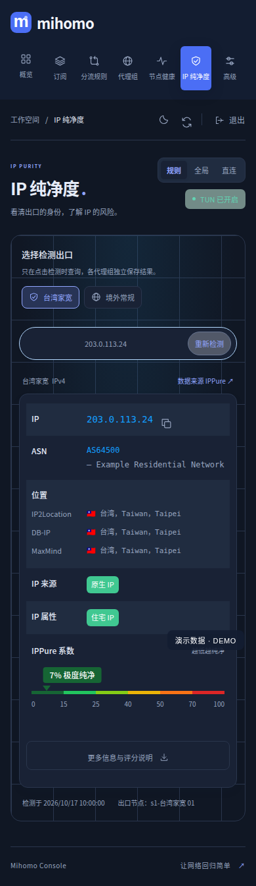

# Mihomo Console

一个面向家庭宽带与常规出口分流的 Mihomo 透明代理控制台。

让 AI 服务走指定的家宽节点，其他境外服务走常规出口；需要新增服务时，添加域名规则并选择代理组即可。日常操作集中在七个页面，复杂的内核操作可以继续使用集成的 MetaCube XD。

后端使用 FastAPI / SQLite，前端使用浏览器原生 ES Modules，无前端构建步骤。适用于 Linux / systemd；当前配置生成器保留了原部署环境的校园网 DNS 与 TUN 定制。

## 界面预览

以下图片由实际前端在浏览器中截图，订阅、节点、IP 与统计均为演示数据。截图生成过程不读取运行数据库或访问外部检测服务。



<details>
<summary>查看更多页面</summary>

### 代理组与节点选择

按卡片勾选成员，在组内展开关联规则的域名。





### 节点健康

按订阅查看节点，最近测速支持悬浮查看时间与延迟。



### IP 纯净度

各代理组分别检测出口，展示 IPPure 网页接口返回的属性与风险系数。



### 手机与深色主题



</details>

## 功能

| 页面 | 可以做什么 |
| --- | --- |
| 概览 | 查看网速、流量曲线、连接数、内存、最近连接、订阅用量，以及各组的出口 IP 和延迟 |
| 订阅 | 管理多个订阅、更新周期、流量配额与到期时间 |
| 分流规则 | 为 AI、Google 或自定义域名设置出口；支持优先级与规则集 |
| 代理组 | 卡片勾选节点，选择自动回退、自动测速或手动切换，查看关联域名 |
| 节点健康 | 按订阅切换，查看最近 24 次测速、延迟、连续失败与短暂停用 |
| IP 纯净度 | 按组查询 ASN、多家定位、原生/广播属性、IP 类型和风险色带 |
| 高级 | 打开 MetaCube XD、查看版本与升级内核 |

还包括浅色/深色主题、刷新后恢复当前 Tab、Shell / PowerShell / CMD 代理命令复制，以及供其他电脑使用的 SSH 隧道指引。

## 分流方式

```text
AI 服务域名 ──→ 台湾家宽 ──→ 用户勾选的家宽节点
其他境外流量 ─→ 境外常规 ──→ 用户勾选的常规节点
自定义服务 ───→ 指定代理组 ─→ 用户勾选的节点
```

新安装会创建默认代理组与 AI 规则，但**不内置订阅或节点凭据**。请自行添加订阅，在代理组中勾选成员，再根据实际节点调整组名与规则。

- 规则通过组 ID 关联，改组名不会破坏引用。规则按优先级执行，默认境外出口承担其余流量。
- 组成员保存「订阅 ID + 原始节点名」。多订阅时内核使用 `s{id}-` 前缀，单订阅不加前缀；新增订阅不会自动把新节点加入已有组。
- 空组使用 `REJECT`，避免无可用节点时意外走直连或其他未选择出口。
- 配置由 `app/render.py` 生成。订阅、组和规则修改先校验，失败保留原数据库与配置。

## 检测与刷新

概览每 2 秒读取内核连接快照，计算速率并维护最近 90 个采样点。页面隐藏时停止轮询；内核不提供有效内存值时回退到服务进程的 RSS。后台界面数据刷新与外部出口检测彼此独立。

| 检测 | 发起时机 | 说明 |
| --- | --- | --- |
| 概览出口 IP / 网络延迟 | 页面重载后的首次展示概览，或手动点击卡片 / 页面刷新 | 切换组、IP 来源、Tab 和节点变化均不自动检测 |
| IP 纯净度 | 仅点击开始检测、重新检测或此页面的刷新按钮 | 按组保存本次浏览器会话的最近报告 |
| 节点健康 | 内核测速与后台健康采样，也支持手动检测 | 按实际测速时间去重，不把重复读取算成新测速 |

手动出口刷新没有冷却时间；进行中的同一请求会合并，避免重复点击产生并发探测。页面保留检测时间与当时的节点，出口变化后提示手动重测。

IP 查询支持 IP.SB、ipwho.is、ipapi.is。网络延迟为 Google / Cloudflare / GitHub 的 HTTPS 请求耗时，包含代理建连、TLS 与响应头等待，平均值只计成功请求。

所有组检测都经过同一 Mihomo 内核的 [listener `proxy` 绑定](https://wiki.metacubex.one/config/inbound/listeners/)。诊断入站仅监听 `127.0.0.1`，端口为 `20000 + 组 ID`；组 ID 大于 45535 时不生成检测入口。检测不会改变组选择、模式或分流规则，入口不可用时直接报错。

### IPPure 数据

使用 [IPPure](https://ippure.com/) 当前网页的数据接口，而不是按节点名称推断：

| 展示项 | 原始字段 |
| --- | --- |
| 原生 / 广播 IP | `ip-basic` 的 `traits.is_broadcast` |
| 住宅、机房、商业、教育等属性 | `ip-basic` 的 `asn.type` |
| ASN 与定位 | `ip-basic` 的 `asn`、`geo` |
| IPPure 系数 | `ip-risk` 的 `risk_score` |

先确定选中组的出口 IP，再通过同一组查询该 IP。当前网页 API 位于 `https://api.123169.xyz/api/info/`；客户端按网页流程处理服务器发放的临时匿名会话，密钥仅保留在内存，不进入数据库、日志或 API 响应。

色带采用原站的 0、15、25、40、50、70、100 分界，**数值越低风险越低**。缺失字段保持未知；风险接口失败时保留基本信息，不将其显示为 0 分。IPv6 暂无该评分。网页接口可能变化或限流，403 / 429 和连接失败会明确提示，不自动反复重试。

## 本地开发

需要 Python 3.12；运行前端测试还需要 Node.js 20 或更新版本。服务端依赖见 [requirements.txt](requirements.txt)，前端无需 `npm install` 或构建即可运行。

```bash
git clone https://github.com/Little-King2022/mihomo-console.git
cd mihomo-console
python3.12 -m venv .venv
.venv/bin/pip install -r requirements.txt

DATA_DIR="$PWD/.local/data" \
MIHOMO_HOME="$PWD/.local/mihomo" \
MIHOMO_API="http://127.0.0.1:19091" \
.venv/bin/uvicorn app.main:app --host 127.0.0.1 --port 8787
```

以上命令将开发数据与正式代理隔离；未连接内核时，页面会展示内核不可用状态。首次启动生成登录令牌，保存在 `.local/data/token`，请只在本机读取后登录，不提交或粘贴到 issue。

| 环境变量 | 默认值 | 用途 |
| --- | --- | --- |
| `DATA_DIR` | `/opt/mihomo-console/data` | SQLite、登录令牌与配置锁 |
| `MIHOMO_HOME` | `/opt/mihomo` | 内核二进制与生成配置目录 |
| `MIHOMO_API` | `http://127.0.0.1:19090` | 内核控制 API |

令牌与内核密钥在首次初始化时随机生成。现有数据库中的订阅、节点选择和密钥不会因更新源码而删除或重建。

## Linux / systemd 部署

部署示例面向已安装 Mihomo 的服务器。先核对 [render.py](app/render.py) 中的 DNS、TUN 路由排除和网络环境，再接管实际流量；不要同时运行两套占用 TUN 或 7890 的内核。

当前模板包括校园网例外：`auth-6441.wifi.com` 使用 `10.64.0.134` 解析，`+.littleking.site`、`+.njau.edu.cn` 保持原有直连解析，TUN 排除私网与保留地址。迁移到其他网络时应有意识地调整这些设置，并执行配置校验。

| 路径 | 内容 |
| --- | --- |
| `/opt/mihomo-console/app` | 正在运行的控制台副本 |
| `/opt/mihomo-console/.venv` | Python 依赖 |
| `/opt/mihomo-console/data` | 私有运行数据；不进入 Git |
| `/opt/mihomo/mihomo` | 内核可执行文件 |
| `/opt/mihomo/config/config.yaml` | 自动生成的配置；不要手改 |
| `/opt/mihomo/config/providers`、`ruleset` | 订阅与规则缓存；不进入 Git |

1. 将代码与 Python 依赖安装到 `/opt/mihomo-console`，准备 `mihomo` 服务用户及其内核目录。
2. 按服务器情况调整 [systemd 示例](deploy/mihomo-console.service) 与 [内核服务示例](deploy/mihomo.service)，再安装到 systemd。
3. 按 [Nginx 示例](deploy/nginx.example.conf) 配置站点名称、访问范围和 TLS；备用端口示例见 [nginx-alt.example.conf](deploy/nginx-alt.example.conf)。示例默认仅允许本机和 `10.0.0.0/8`。
4. 内核认证头保存在服务器私有的 `/etc/nginx/snippets/mihomo-console-core-auth.conf`，由站点 include；该文件应设置受限权限，不能提交到仓库。
5. 在控制台添加订阅、勾选组成员并配置规则，校验后再让内核接管流量。

控制台监听 `127.0.0.1:8787`；内核控制 API 为 `127.0.0.1:19090`。Nginx 的 `/api/`、`/static/` 与首页转到控制台，MetaCube XD 与内核接口经过控制台登录认证后代理。安装 MetaCube XD 后，在已登录会话打开 `/ui/`，无需将内核密钥传给浏览器。

### 更新运行副本

在源码目录执行：

```bash
sudo rsync -a app/ /opt/mihomo-console/app/
sudo systemctl restart mihomo-console
```

只有修改了配置生成逻辑或需要应用网络配置时，再执行：

```bash
sudo DATA_DIR=/opt/mihomo-console/data MIHOMO_HOME=/opt/mihomo \
  /opt/mihomo-console/.venv/bin/python -c 'from app import service; service.apply_config()'
```

`apply_config()` 先运行内核 `-t`，成功后替换配置并重载。顺序必须是「同步 → 重启控制台 → 应用配置」，避免后台健康检查继续使用旧模块写回旧配置。仅更新文档不需要重启服务。

### 手动使用代理

概览从内核读取真实的 HTTP / mixed 端口与监听范围，提供 Shell、PowerShell、CMD 的启用/关闭命令及复制按钮。HTTPS 代理变量同样填写 `http://` 地址。

默认 mixed 端口 7890 只供服务器本机使用。其他电脑可以用页面提供的 SSH 隧道指引；页面不会为此自动开启 LAN 监听。

### 登录与访问日志

浏览器使用 HttpOnly 会话 Cookie。支持 `https://console.example.com/?token=YOUR_TOKEN#groups` 直链登录：前端读取后立即移除 token 参数，通过 POST 验证。Uvicorn 访问日志对 token 参数脱敏，Nginx 示例关闭访问日志并设置 `Referrer-Policy: no-referrer`。分享文档或截图时仍应使用无凭据 URL。

## 代码结构

```text
app/
  main.py              HTTP API、认证与脱敏访问日志
  db.py                SQLite、默认组、规则与迁移；无内置订阅
  render.py            生成 Mihomo 配置
  service.py           健康采样、事务、配置应用与内核维护
  diagnostics.py       按组检测、并发合并与诊断快照
  ippure.py            IPPure 网页接口与字段归一化
  static/
    app.js             初始化与会话级操作
    app.css            主题与页面样式
    js/core/           API、共享状态、会话、事件与数据加载
    js/pages/          七个页面
    js/features/       节点选择、出口检测与代理命令
    js/ui/             测速历史、图表、复制、弹窗等组件
    js/router.js       Tab 与页面状态恢复
    js/polling.js      遥测与可见性处理
deploy/                不含认证头的 systemd / Nginx 示例
docs/                  演示数据与已脱敏截图
scripts/               截图与发布检查工具
tests/                 Python 与原生 Node.js 测试
```

模块通过显式 import 组合，页面不反向导入入口或路由。静态资源使用 `Cache-Control: no-cache`，部署后重新验证模块，避免混用缓存文件。维护约束见 [AGENTS.md](AGENTS.md)。

## 验证

```bash
.venv/bin/python -m unittest discover -s tests
npm run test:frontend
```

在真实部署机修改内核配置后还需执行：

```bash
sudo /opt/mihomo/mihomo -t -d /opt/mihomo/config -f /opt/mihomo/config/config.yaml
systemctl is-active mihomo mihomo-console
```

测试使用临时数据库和模拟上游；浏览器验证应涵盖登录、Tab 恢复、节点选择、测速提示、复制、手动检测和手机布局。当前默认规则下，ChatGPT 应匹配 `台湾家宽`，其他境外域名应匹配 `境外常规`。

### 重新生成截图

安装可选的 Playwright 与 Chromium 后：

```bash
npm install --no-save --package-lock=false playwright
npx playwright install chromium
node scripts/capture-screenshots.mjs
```

脚本默认访问 `http://127.0.0.1:8787`，可通过 `SCREENSHOT_BASE_URL` 修改。所有 API 都由 [演示数据](docs/demo-data.json) 接管，无需真实登录令牌；外部网络请求会被阻止。使用系统 Chrome 时可设置 `CHROMIUM_PATH`。

## 公开发布约定

运行数据库、订阅地址、节点密码、令牌、内核认证头、环境文件、缓存、备份和本机运维记录都不属于公开源码，已加入 `.gitignore`。公开示例使用保留域名与文档地址，不内置真实订阅。

提交前执行 `python3.12 scripts/check-public-files.py`，再检查 `git diff --cached` 和实际暂存文件。该工具只报告路径与问题类型，不打印敏感值。秘密扫描无法代替人工审核；图片和新增配置文件也要检查。

本项目使用 [Mihomo](https://github.com/MetaCubeX/mihomo) 提供代理内核，[MetaCube XD](https://github.com/MetaCubeX/metacubexd) 提供高级面板，IPPure 提供查询数据。相关软件和数据的许可、可用性与解释以其各自项目为准。
