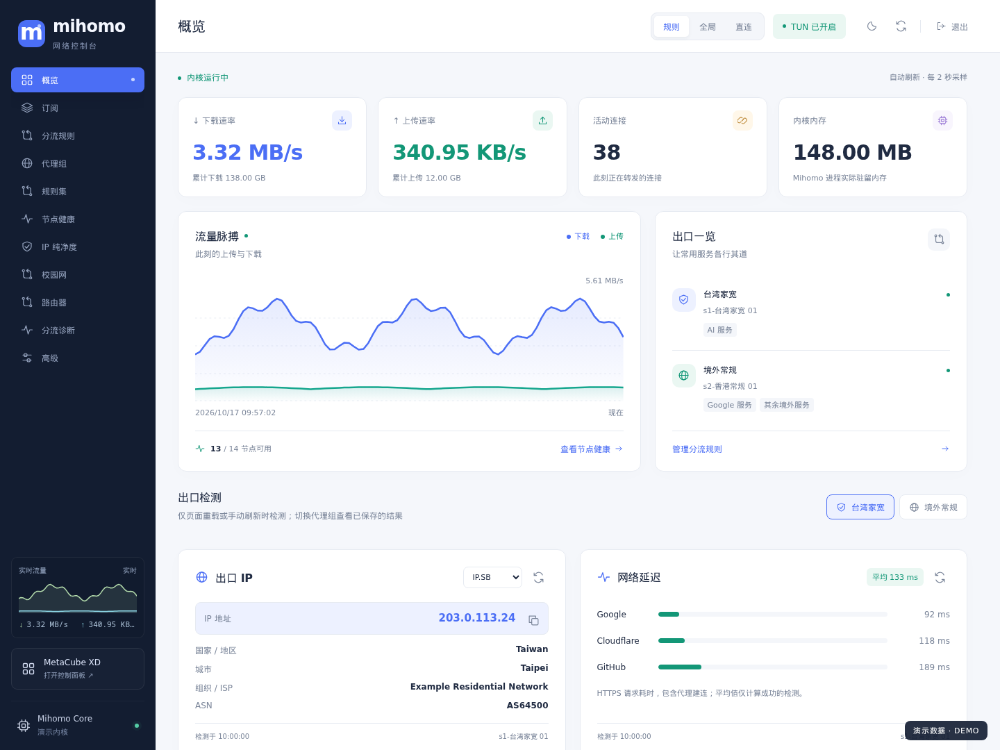
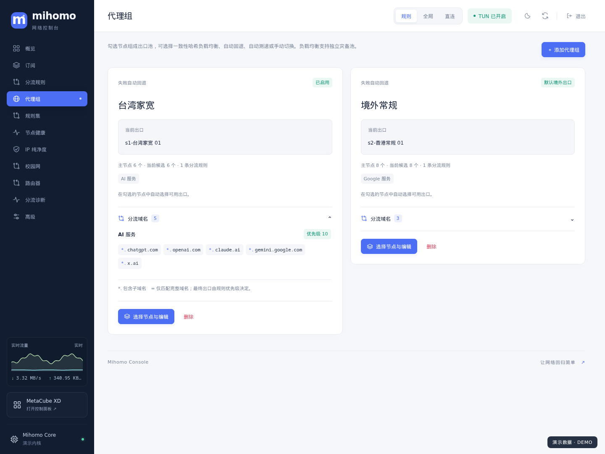
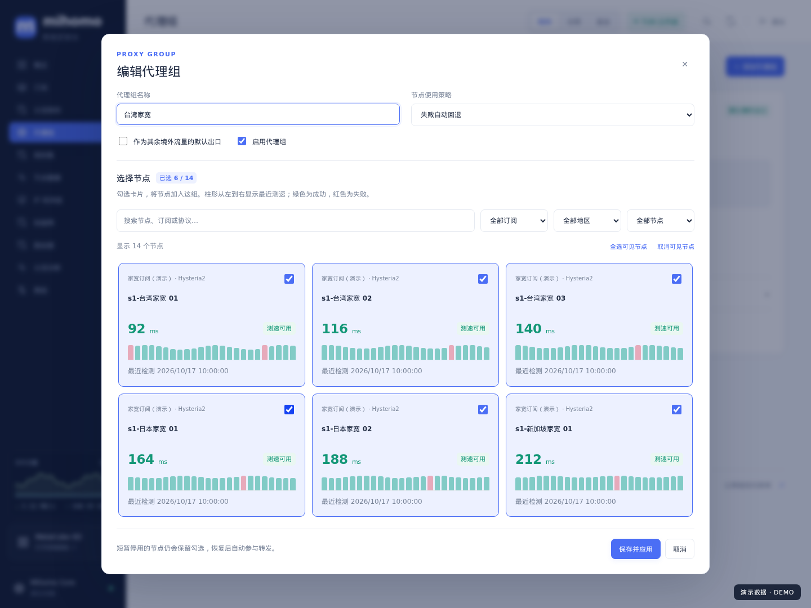
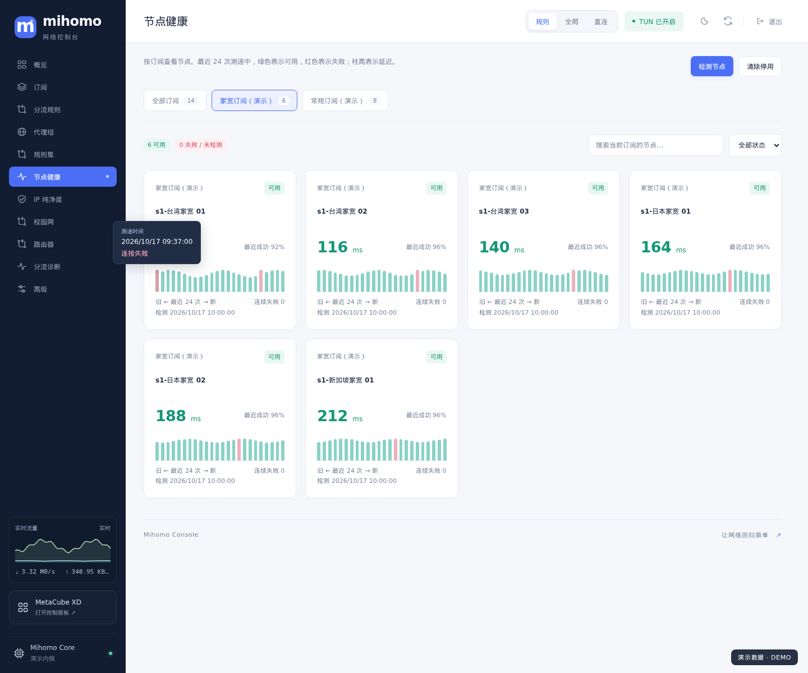
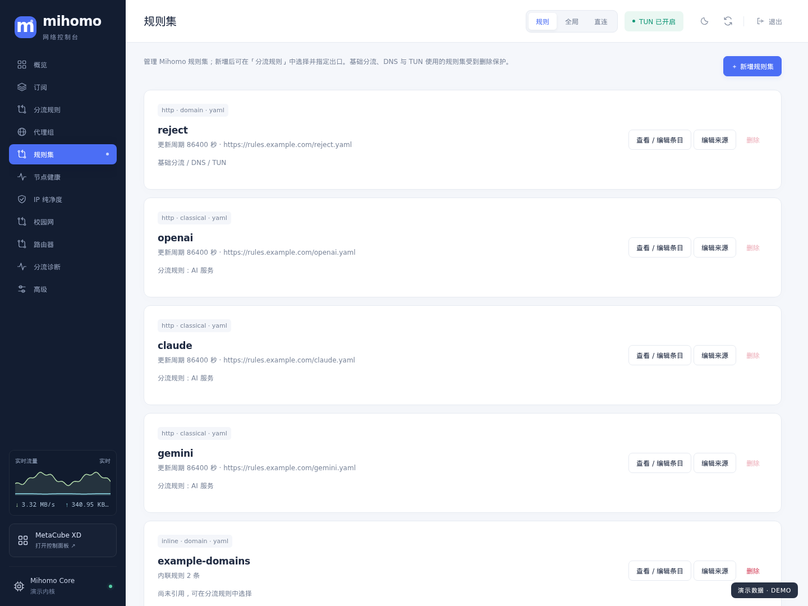
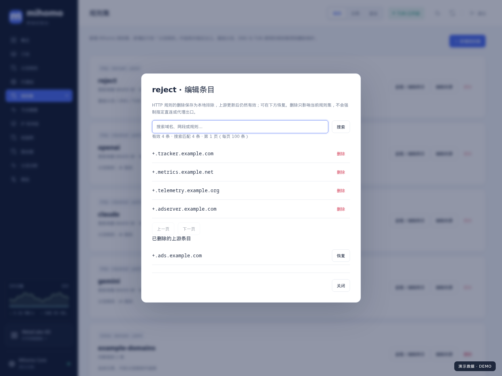
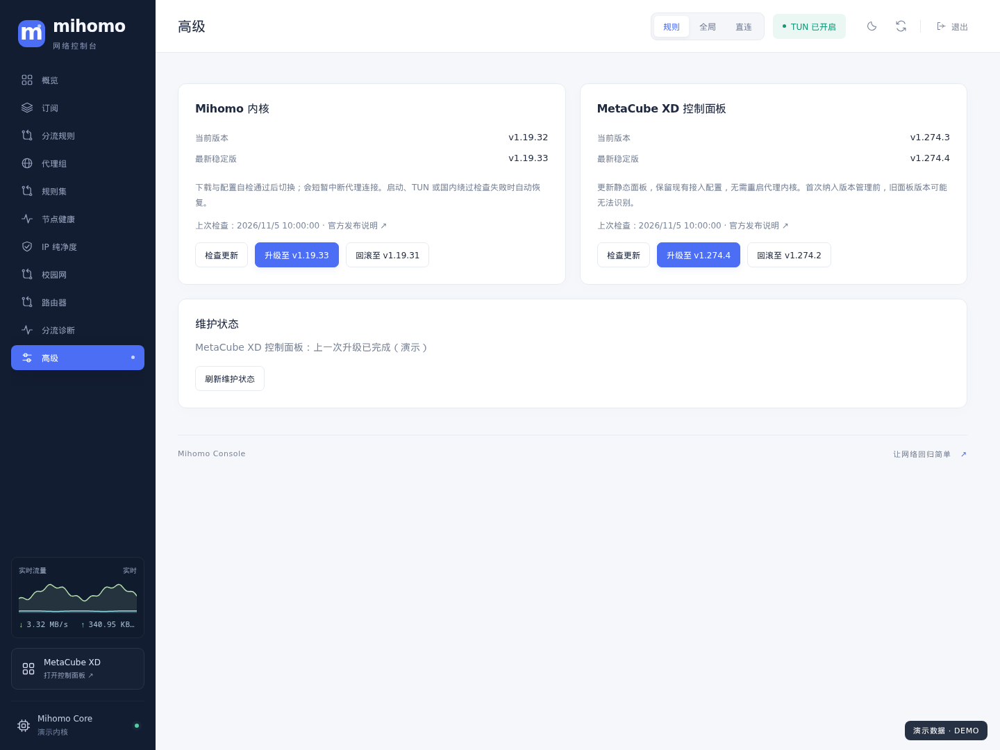
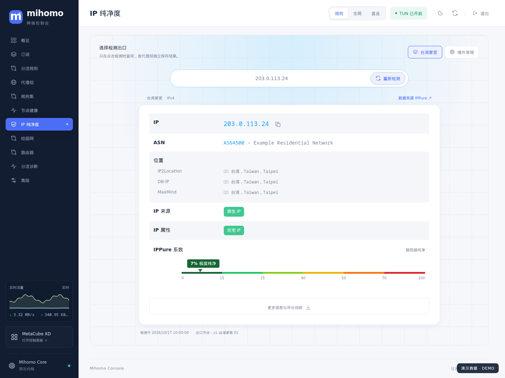
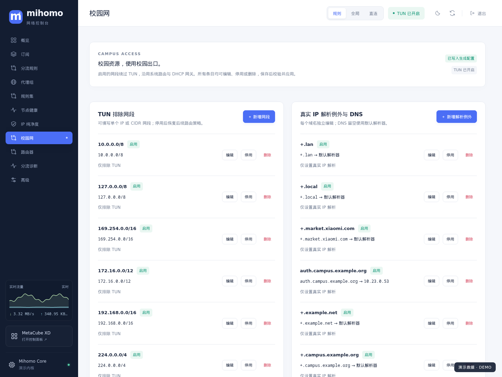
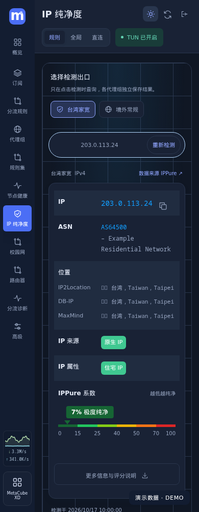

# Mihomo Console

一个面向 Linux 路由器的 Mihomo 管理控制台，统一管理透明代理、校园网路由、DNS、DHCP 和 NAT。

按服务选择代理组，在节点卡片中勾选出口；校园网直连、国内绕过与境外代理分别按保存的规则执行。日常操作集中在十一个页面，完整连接与内核信息也可通过左侧的 MetaCube XD 入口查看。

后端使用 FastAPI / SQLite，前端使用浏览器原生 ES Modules，无前端构建步骤。适用于 Linux / systemd；当前配置生成器保留了原部署环境的校园网 DNS 与 TUN 定制。

## 界面预览

以下图片由实际前端在浏览器中截图，订阅、节点、IP 与统计均为演示数据。截图生成过程不读取运行数据库或访问外部检测服务。



<details>
<summary>查看更多页面</summary>

### 代理组与节点选择

按卡片勾选成员，在组内展开关联规则的域名。





### 节点健康

按订阅查看节点，最近测速支持悬浮查看时间与延迟。



### 规则集与条目维护

管理来源与引用，搜索并删除集合中的单条规则；上游更新后仍保留本地排除。





### 内核与面板维护

分别检查稳定版本、升级和回滚，查看后台任务状态。



### IP 纯净度

各代理组分别检测出口，展示 IPPure 网页接口返回的属性与风险系数。



### 校园网

管理绕过网段与域名 DNS，查看校园出口与系统路由，按需检查连通性。



### 手机与深色主题



</details>

## 功能

| 页面 | 可以做什么 |
| --- | --- |
| 概览 | 查看网速、流量曲线、连接数、内存、最近连接、订阅用量，以及各组的出口 IP 和延迟 |
| 订阅 | 管理多个订阅、更新周期、流量配额与到期时间 |
| 分流规则 | 为 AI、Google 或自定义域名设置出口；支持优先级与规则集 |
| 代理组 | 卡片勾选节点，选择自动回退、自动测速或手动切换，查看关联域名 |
| 规则集 | 管理 HTTP / 内联集合，搜索条目、逐条删除及恢复，保留上游更新 |
| 节点健康 | 按订阅切换，查看最近 24 次测速、延迟、连续失败与短暂停用 |
| IP 纯净度 | 按组查询 ASN、多家定位、原生/广播属性、IP 类型和风险色带 |
| 校园网 | 编辑全部 TUN 排除网段、真实 IP 解析例外与 DNS，查看实际网卡、主路由表，手动检查路由、Ping、TCP 和 DNS |
| 路由器 | 管理导入的校园静态路由、DHCP、固定租约、双出口 NAT 与端口转发 |
| 分流诊断 | 输入域名或 IPv4，检查 LAN DNS、真实/Fake IP、运行中的内核绕过与规则、系统路由、LAN NAT 候选；可选连接实测 |
| 高级 | 分别检查、升级和回滚 Mihomo 内核与 MetaCube XD，查看后台维护进度 |

界面采用固定左侧导航、固定右侧顶部信息栏与独立滚动的内容区；页面名称、代理模式、TUN、主题、刷新和退出始终可见，MetaCube XD 入口固定在左侧。侧栏还有绿色下载、蓝色上传的实时流量小图。窄屏使用紧凑侧栏和两行顶部控件。还包括浅色/深色主题、刷新后恢复当前 Tab、Shell / PowerShell / CMD 代理命令复制，以及供其他电脑使用的 SSH 隧道指引。

## 分流方式

```text
AI 服务域名 ──→ 台湾家宽 ──→ 用户勾选的家宽节点
其他境外流量 ─→ 境外常规 ──→ 用户勾选的常规节点
自定义服务 ───→ 指定代理组 ─→ 用户勾选的节点
```

新安装会创建默认代理组与 AI 规则，但**不内置订阅或节点凭据**。请自行添加订阅，在代理组中勾选成员，再根据实际节点调整组名与规则。

- 规则通过组 ID 关联，改组名不会破坏引用。规则按优先级执行，默认境外出口承担其余流量。
- 组成员保存「订阅 ID + 原始节点名」。多订阅时内核使用 `s{id}-` 前缀，单订阅不加前缀；新增订阅不会自动把新节点加入已有组。
- 空组使用 `REJECT`，避免无可用节点时意外走直连或其他未选择出口。
- 自动回退、自动测速由内核处理节点故障；健康采样与短期冷却不会改动自动组成员或触发其重载，避免打断已有连接。
- 配置由 `app/render.py` 生成。订阅、组和规则修改先校验，失败保留原数据库与配置。

## 检测与刷新

页面可见时每 2 秒共享读取一次内核连接快照，左侧实时流量小图在所有 Tab 显示最近的上下行趋势及速率，页面隐藏时暂停；不会因此触发出口或 IP 检测。概览使用同一份快照，计算速率并维护最近 90 个采样点。未知或离线不会显示成 0 速率；内核不提供有效内存值时回退到服务进程的 RSS。后台界面数据刷新与外部出口检测彼此独立。

| 检测 | 发起时机 | 说明 |
| --- | --- | --- |
| 概览出口 IP / 网络延迟 | 页面重载后的首次展示概览，或手动点击卡片 / 页面刷新 | 切换组、IP 来源、Tab 和节点变化均不自动检测 |
| IP 纯净度 | 仅点击开始检测、重新检测或此页面的刷新按钮 | 按组保存本次浏览器会话的最近报告 |
| 节点健康 | 内核测速与后台健康采样，也支持手动检测 | 按实际测速时间去重，不把重复读取算成新测速 |

fallback / url-test 组由内核按节点健康自动选择可用出口，切换时保留已有连接。控制台继续记录健康与短暂停用状态，但不再将临时冷却名单写入这两类组的排除规则；手动 select 组保留冷却排除。生成内容与当前配置文件相同时，跳过内核自检和重载，避免周期性断开长连接；仅修改 NAT、DHCP 等设置时，仍会校验和应用路由器自有资源。

手动出口刷新没有冷却时间；进行中的同一请求会合并，避免重复点击产生并发探测。页面保留检测时间与当时的节点，出口变化后提示手动重测。

IP 查询支持 IP.SB、ipwho.is、ipapi.is。网络延迟为 Google / Cloudflare / GitHub 的 HTTPS 请求耗时，包含代理建连、TLS 与响应头等待，平均值只计成功请求。

所有组检测都经过同一 Mihomo 内核的 [listener `proxy` 绑定](https://wiki.metacubex.one/config/inbound/listeners/)。诊断入站仅监听 `127.0.0.1`，端口为 `20000 + 组 ID`；组 ID 大于 45535 时不生成检测入口。检测不会改变组选择、模式或分流规则，入口不可用时直接报错。

### 分流诊断

打开「分流诊断」，输入具体域名或 IPv4 和 TCP 端口，手动点击「开始诊断」。工具查询 LAN DNS 的 A 记录，读取内核 API 的运行模式与规则，并检查实际 nftables OUTPUT / PREROUTING 的目标地址返回规则。它区分 Linux 内核直连、进入 Mihomo 与 TUN 关闭；不会仅凭 `DIRECT` 或 `ip route get` 声称绕过了代理。多个 A 记录分别分析，最多展示 8 个。

规则预测使用运行中的规则顺序及本机规则集缓存，支持域名、后缀、关键词、IPv4 CIDR，以及 domain/ipcidr 和含上述类型的 classical 规则集；遇到无法求值的前序规则（例如 GEOIP/GEOSITE）明确标记候选结果。当前组选择链、系统路由与已配置的 LAN NAT 供排查参考；DNS 上游展示配置值，不将缓存查询说成对指定上游的实时抓包。IPv6、UDP、终端策略路由与端口转发入站诊断暂不包含。

勾选「同时连接实测」后，仅对首个 A 记录发起一次本机 TCP 连接；443 端口还验证 TLS 证书。通过本次连接的源 IP、源端口和目标端口关联 `/connections`，展示内核实际记录的规则及节点链。TLS 失败保留已捕获的规则，不自动换节点或重试。其他端口仅完成 TCP 建连，透明代理本地接受连接不等于远端已响应。未找到连接记录不能单独证明内核直连，LAN NAT 也不冒充已抓取的终端会话。诊断需要 `dig`、`ip` 与读取 nftables 的权限；不会修改配置、模式、节点或防火墙。

### 规则集管理

「规则集」Tab 管理 Mihomo 的 `rule-providers`：支持 HTTP 下载来源和内联内容，行为可选 `domain`、`ipcidr`、`classical`，文件格式可选 YAML、text、MRS（MRS 不支持 classical）。HTTP 来源可修改 URL 和更新周期；内联内容每行一条，不包含 `payload:` 标头。名称创建后不可修改。

点击「查看 / 编辑条目」可搜索和分页查看 YAML / text 规则，并逐条删除。HTTP 来源的删除记录保存为本地排除，可在「已删除的上游条目」恢复；内联来源直接修改规则内容。MRS 为二进制格式，须改用 YAML / text 来源才能编辑条目。HTTP 原始来源继续由内核按原周期更新，控制台在后台检查时发布过滤后的文件快照；更新失败保留上一版。过滤文件使用不可变版本路径，失败不会覆盖正在使用的规则。

新增集合不会自动改变流量；在「分流规则」中勾选集合并选择代理组后生效。修改和删除使用同一跨进程配置锁、数据库事务与内核自检，失败保留原设置。引用中的集合（含停用规则和旧组规则）须先解除引用才能删除。六个基础集合用于默认分流、DNS 与 TUN 国内绕过，允许修改下载地址和更新周期，保留其名称、来源类型、行为和格式并禁止删除。

原固定集合仅在升级时迁移一次，此后以数据库列表为准，删除的可选集合不会在重启时补回。HTTP 下载缓存由控制台生成路径，修改来源或格式后使用独立缓存。下载经过 DIRECT；内联内容和远程文件须符合 [Mihomo 规则集合格式](https://wiki.metacubex.one/config/rule-providers/)。MRS 内容暂不在代理组域名预览中展开，分流诊断遇到无法解析的集合会标明不确定性。

负载均衡功能已移除。升级时原负载均衡组通过配置事务迁移为自动回退，保留组 ID、名称、已选主节点、分流与订阅下载引用；原灾备元数据保留用于回滚，但不参与新配置。空选择或节点消失继续 REJECT，不扩充节点来源。校园路由、DHCP、DNS 与 NAT 继续使用原设置。

### IPPure 数据

使用 [IPPure](https://ippure.com/) 当前网页的数据接口，而不是按节点名称推断：

| 展示项 | 原始字段 |
| --- | --- |
| 原生 / 广播 IP | `ip-basic` 的 `traits.is_broadcast` |
| 住宅、机房、商业、教育等属性 | `ip-basic` 的 `asn.type` |
| ASN 与定位 | `ip-basic` 的 `asn`、`geo` |
| IPPure 系数 | `ip-risk` 的 `risk_score` |

先确定选中组的出口 IP，再通过同一组查询该 IP。当前网页 API 位于 `https://api.123169.xyz/api/info/`；客户端按网页流程处理服务器发放的临时匿名会话，密钥仅保留在内存，不进入数据库、日志或 API 响应。

色带采用原站的 0、15、25、40、50、70、100 分界，**数值越低风险越低**。缺失字段保持未知；风险接口失败时保留基本信息，不将其显示为 0 分。IPv6 暂无该评分。网页接口可能变化或限流，403 / 429 和连接失败会明确提示，不自动反复重试。

## 本地开发

需要 Python 3.12；运行前端测试还需要 Node.js 20 或更新版本。服务端依赖见 [requirements.txt](requirements.txt)，前端无需 `npm install` 或构建即可运行。

```bash
git clone https://github.com/Little-King2022/mihomo-console.git
cd mihomo-console
python3.12 -m venv .venv
.venv/bin/pip install -r requirements.txt

MIHOMO_OFFLINE=1 \
DATA_DIR="$PWD/.local/data" \
MIHOMO_HOME="$PWD/.local/mihomo" \
MIHOMO_API="http://127.0.0.1:19091" \
.venv/bin/uvicorn app.main:app --host 127.0.0.1 --port 8787
```

以上命令将开发数据与正式代理隔离；未连接内核时，页面会展示内核不可用状态。首次启动生成登录令牌，保存在 `.local/data/token`，请只在本机读取后登录，不提交或粘贴到 issue。

| 环境变量 | 默认值 | 用途 |
| --- | --- | --- |
| `DATA_DIR` | `/opt/mihomo-console/data` | SQLite、登录令牌与配置锁 |
| `MIHOMO_HOME` | `/opt/mihomo` | 内核二进制与生成配置目录 |
| `MIHOMO_API` | `http://127.0.0.1:19090` | 内核控制 API |
| `MIHOMO_OFFLINE` | `0` | 本地开发设为 `1`，禁止切换或重载正式内核服务；仍需隔离 API 和数据目录 |
| `ROUTER_MANAGEMENT` | 未启用 | 仅设为 `1` 时允许应用已导入的路由器网络设置 |

令牌与内核密钥在首次初始化时随机生成。现有数据库中的订阅、节点选择和密钥不会因更新源码而删除或重建。

## Linux / systemd 部署

部署示例面向已安装 Mihomo 的服务器。先核对 [render.py](app/render.py) 中的 DNS、TUN 路由排除和网络环境，再接管实际流量；不要同时运行两套占用 TUN 或 7890 的内核。

升级会将旧部署的校园认证 DNS、真实 IP 域名例外及私网 / 保留地址排除迁移为普通可编辑条目。之后全部以用户保存的列表为准，停用、删除或清空不会恢复旧值。请按本机网络填写域名和 DNS，不照抄其他机器的校园参数。

### 校园网管理

打开「校园网」Tab，在「TUN 排除网段」列表中新增、编辑、启停或删除 IPv4 地址及 CIDR 网段，例如文档示例 `192.0.2.0/24`（请替换为实际网段）。启用条目会加入 [`tun.route-exclude-address`](https://wiki.metacubex.one/config/inbound/tun/#route-exclude-address)，让透明代理流量绕过 TUN，继续使用系统路由。原有私网、回环、保留地址均为普通可编辑条目，没有固定保留项；停用或删除后不会自动恢复，其他启用条目的重叠范围仍有效。

「真实 IP 解析例外与 DNS」列表支持编辑全部域名，包括升级迁入的认证域名及 `+.lan` 等例外。`+.example.edu.cn` 表示包含子域名（示例须替换为本机实际域名）。启用条目加入 `fake-ip-filter`，DNS 服务器留空时使用默认解析器；填写一个或多个 IPv4 地址时还会写入 `nameserver-policy`，并在已有排除网段未覆盖该服务器时自动添加其 `/32` 排除。需要移除此自动排除时，请一并清空、停用或删除对应 DNS 设置。

网段与域名可勾选「同时启用直连规则」，供显式 HTTP / SOCKS 代理客户端使用；这类客户端仍会进入内核。升级迁入的旧条目保留原有行为，不额外增加 DIRECT 规则。网段、解析例外及 DNS 可全部清空，后台刷新、配置重绘与控制台重启都不会补回旧参数。

配置存入现有 SQLite 的 `campus_config` 设置，使用跨进程配置锁和事务执行内核自检，失败保留数据库与原配置。页面的「已写入生成配置」只表示保存设置与生成文件一致；实际出口需用「实际出口路由」检查。

「系统网卡与路由」展示本机主路由表、源 IP、网关及 NetworkManager 下发的 DNS；网卡地址、默认网关和系统静态路由仍由 Linux 网络管理器维护。本页管理 TUN 绕过路由，不向系统写入额外默认路由。是否使用校园 IP 取决于目标的实际系统路由，排除 TUN 本身不会创建网关或执行校园认证。

检查仅由用户手动触发，切换 Tab、刷新状态和后台轮询不会发起探测。目标限于私网、启用的校园网段或校园 DNS；DNS 检查限于已配置的域名和对应服务器。检测会确认路由表、物理网卡、接口状态及源地址，遇到隧道、容器桥接或本机回环出口即报错，不切换其他出口。Ping / TCP / DNS 使用校园源 IP，保留检测时的出口、时间和结果；Ping 失败可能只是目标不响应 ICMP。

运行环境需有 `ip`（iproute2）；Ping 需要 `ping`，DNS 检查需要 `dig`（Debian / Ubuntu 的 dnsutils）。工具缺失、权限不足、超时和无 DNS 记录均会明确报错。当前内核模板关闭 IPv6，本页暂仅管理 IPv4。

| 路径 | 内容 |
| --- | --- |
| `/opt/mihomo-console/app` | 正在运行的控制台副本 |
| `/opt/mihomo-console/.venv` | Python 依赖 |
| `/opt/mihomo-console/data` | 私有运行数据；不进入 Git |
| `/opt/mihomo/mihomo` | 内核可执行文件 |
| `/opt/mihomo/config/config.yaml` | 自动生成的配置；不要手改 |
| `/opt/mihomo/config/providers`、`ruleset` | 订阅与规则缓存；不进入 Git |

1. 将代码与 Python 依赖安装到 `/opt/mihomo-console`，准备 `mihomo` 服务用户及其内核目录。
2. 按服务器情况调整 [控制台服务](deploy/mihomo-console.service)、[内核服务](deploy/mihomo.service) 与 [网络恢复服务](deploy/mihomo-console-network.service)，再安装到 systemd。
3. 按 [Nginx 示例](deploy/nginx.example.conf) 配置站点名称、访问范围和 TLS；备用端口示例见 [nginx-alt.example.conf](deploy/nginx-alt.example.conf)。示例默认仅允许本机和 `10.0.0.0/8`。
4. 内核认证头保存在服务器私有的 `/etc/nginx/snippets/mihomo-console-core-auth.conf`，由站点 include；该文件应设置受限权限，不能提交到仓库。
5. 在控制台添加订阅、勾选组成员并配置规则，校验后再让内核接管流量。

控制台监听 `127.0.0.1:8787`；内核控制 API 为 `127.0.0.1:19090`。Nginx 的 `/api/`、`/static/` 与首页转到控制台，MetaCube XD 与内核接口经过控制台登录认证后代理。安装 MetaCube XD 后，在已登录会话打开 `/ui/`，无需将内核密钥传给浏览器。

### 路由器管理与 TUN 分流

导入本机网络配置后，设置 `ROUTER_MANAGEMENT=1`，由“路由器”页面统一维护校园静态路由、DHCP 地址池与固定租约、主机真实 DNS、源地址转换及端口转发。现有网桥成员、管理地址和主出口 DHCP 保持导入时的拓扑；日常修改通过面板完成，生成文件不再手改。订阅页面可选择订阅下载所用的代理组，引用使用组 ID，改组名不会破坏关联。

路由器配置保存在 SQLite 的 `router_config`。后端先校验 Mihomo、dnsmasq 与自有 nftables 配置，再应用；失败恢复原文件、专用出口静态路由及自有防火墙表。它只管理 `ip mihomo_console` 表，Docker 继续管理容器规则，不执行全局清空。网页服务的运行账号须具备受管理文件、NetworkManager、nftables 和服务重载权限；当前 systemd 示例使用 root。

TUN 同时启用 `auto-route` 和 `auto-redirect`，覆盖主机、LAN 与容器转发。校园网段按系统路由绕过内核；国内 IP 使用 `cncidr` 内核集合绕过。DNS 先为明确的代理服务返回 Fake IP，为校园与真实解析例外返回真实 IP，其余国内域名使用真实解析；未知域名默认返回真实 IP，再按目标地址分流。不能将包含 Fake IP 地址段的通用 LAN 规则集整体加入 TUN 排除集合。

内核 DNS 使用 `127.0.0.1:1053`，dnsmasq 继续服务 LAN 的 53/67 端口。校园 DNS 可以填写多个 IPv4 地址，以空格或逗号分隔。分流规则还支持 `DOMAIN-KEYWORD,keyword`，迁移的关键词不会被转成域名后缀。

部署时安装 `deploy/mihomo-console-network.service`，让它在 Mihomo 前恢复路由器配置。正式内核服务应依赖并排在此单元之后；旧订阅定时写入任务及旧 TProxy 必须停用，避免两套控制入口竞争。首次切换应另设自动回滚，并分别验证主机、LAN、Docker 的解析、代理和内核直连路径。

当前原生 nftables 后端对地址族最大值的区间有兼容问题，渲染时排除本机有限广播地址以避免启动失败；其余保存的排除范围仍保留。每次应用及后台健康采样会核对国内规则集的每个网段，发现原生集合截断时用 nft 分批补齐并再次核验，避免把“DIRECT”误当作已绕过内核。参见 [上游区间问题](https://github.com/SagerNet/sing-box/issues/4316)、[上游集合完整性问题](https://github.com/MetaCubeX/mihomo/issues/3284)。

### 更新运行副本

在源码目录执行：

```bash
sudo rsync -a app/ /opt/mihomo-console/app/
sudo systemctl restart mihomo-console
```

只有修改了配置生成逻辑或需要应用网络配置时，再执行：

```bash
sudo DATA_DIR=/opt/mihomo-console/data MIHOMO_HOME=/opt/mihomo \
  /opt/mihomo-console/.venv/bin/python -c 'from app import service; service.apply_config()'
```

`apply_config()` 先运行内核 `-t`，成功后替换配置并重载。顺序必须是「同步 → 重启控制台 → 应用配置」，避免后台健康检查继续使用旧模块写回旧配置。仅更新文档不需要重启服务。

### 内核与面板维护

「高级」页分别显示 Mihomo 内核和 MetaCube XD 面板的当前版本、最新稳定版本、检查时间及维护进度。点击「检查更新」才访问官方 GitHub Releases；核对版本与发布说明后点击升级。GitHub API 限流时保留上次成功检查的版本和时间，并明确提示；没有检查记录时不会声称已是最新版本。旧安装的面板没有版本记录时显示「版本未记录」，首次由控制台升级后开始准确记录。

维护任务在后台串行运行，刷新或关闭页面不会重复启动。发布包校验 GitHub 提供的 SHA-256，内核按本机 Linux amd64 / arm64 架构选择，amd64 优先使用兼容的 v1 构建。新内核先执行版本检查与当前配置 `-t` 自检，通过后才停止原内核并切换；启动后验证运行版本、TUN 状态和国内地址集覆盖，失败自动恢复原内核。升级会短暂中断代理连接；仅更新控制台页面不需要升级或重启内核。

面板使用官方 `compressed-dist.tgz` 静态资源包，限制解压大小并拒绝路径穿越和符号链接，保留现有 `config.js`，在切换及回滚时为 Mihomo 用户设置正确的目录和文件读取权限，再检查 `/ui/` 可访问。面板维护无需重启 Mihomo，不修改 Nginx。成功后可用「回滚上一版本」恢复；每次成功切换保存切换前版本。已下载的官方包可在摘要复核后复用，避免重试时重复下载。备份、包缓存及任务记录位于私有数据目录的 `maintenance/`，控制台若在切换时重启，会根据恢复记录还原原版本。

### 手动使用代理

概览从内核读取真实的 HTTP / mixed 端口与监听范围，提供 Shell、PowerShell、CMD 的启用/关闭命令及复制按钮。HTTPS 代理变量同样填写 `http://` 地址。

默认 mixed 端口 7890 只供服务器本机使用。其他电脑可以用页面提供的 SSH 隧道指引；页面不会为此自动开启 LAN 监听。

### 登录与访问日志

浏览器使用 HttpOnly 会话 Cookie。支持 `https://console.example.com/?token=YOUR_TOKEN#groups` 直链登录：前端读取后立即移除 token 参数，通过 POST 验证。Uvicorn 访问日志对 token 参数脱敏，Nginx 示例关闭访问日志并设置 `Referrer-Policy: no-referrer`。分享文档或截图时仍应使用无凭据 URL。

## 代码结构

```text
app/
  main.py              HTTP API、认证与脱敏访问日志
  db.py                SQLite、默认组、规则与迁移；无内置订阅
  render.py            生成 Mihomo 配置
  service.py           健康采样、配置事务、内核重载与遥测
  diagnostics.py       按组检测、并发合并与诊断快照
  routing_diagnostics.py 目标 DNS、运行规则、内核绕过、路由与连接实测
  maintenance.py       内核与面板升级、包校验、备份及中断恢复
  rulesets.py          规则集定义、条目排除及派生文件
  router_config.py     路由器配置校验及系统文件渲染
  router.py            自有网络资源应用、备份与国内绕过核验
  network_boot.py      启动时恢复已导入的路由器配置
  ippure.py            IPPure 网页接口与字段归一化
  campus_config.py     校园配置迁移、可编辑网段与 DNS 校验
  campus.py            校园配置管理、Linux 路由读取与手动检测
  static/
    app.js             初始化与会话级操作
    app.css            主题与页面样式
    js/core/           API、共享状态、会话、事件与数据加载
    js/pages/          十一个页面
    js/features/       节点选择、出口检测与代理命令
    js/ui/             侧栏流量、测速历史、图表、复制与弹窗
    js/router.js       Tab 与页面状态恢复
    js/polling.js      遥测与可见性处理
deploy/                不含认证头的 systemd / Nginx 示例
docs/                  演示数据与已脱敏截图
scripts/               截图与发布检查工具
tests/                 Python 与原生 Node.js 测试
```

模块通过显式 import 组合，页面不反向导入入口或路由。静态资源使用 `Cache-Control: no-cache`，部署后重新验证模块，避免混用缓存文件。维护约束见 [AGENTS.md](AGENTS.md)。

## 验证

```bash
.venv/bin/python -m unittest discover -s tests
npm run test:frontend
```

在真实部署机修改内核配置后还需执行：

```bash
sudo /opt/mihomo/mihomo -t -d /opt/mihomo/config -f /opt/mihomo/config/config.yaml
systemctl is-active mihomo mihomo-console
```

测试使用临时数据库和模拟上游，不连接正式数据库或启动第二套内核。浏览器验证应涵盖登录、Tab 与滚动恢复、节点选择、测速提示、复制、手动检测、规则集条目删除 / 恢复、维护失败回滚、侧栏流量以及深色 / 窄屏布局。实际业务规则及出口应符合用户保存的组与节点选择，不以固定组名判断成功。

### 重新生成截图

安装可选的 Playwright 与 Chromium 后：

```bash
npm install --no-save --package-lock=false playwright
npx playwright install chromium
node scripts/capture-screenshots.mjs
```

脚本默认访问 `http://127.0.0.1:8787`，可通过 `SCREENSHOT_BASE_URL` 修改。所有 API 都由 [演示数据](docs/demo-data.json) 接管，无需真实登录令牌；外部网络请求会被阻止。使用系统 Chrome 时可设置 `CHROMIUM_PATH`。

## 公开发布约定

运行数据库、订阅地址、节点密码、令牌、内核认证头、环境文件、缓存、备份和本机运维记录都不属于公开源码，已加入 `.gitignore`。公开示例使用保留域名与文档地址，不内置真实订阅。

提交前在已安装依赖的环境执行 `.venv/bin/python scripts/check-public-files.py`，再检查 `git diff --cached` 和实际暂存文件。该工具只报告路径与问题类型，不打印敏感值。秘密扫描无法代替人工审核；图片和新增配置文件也要检查。

本项目使用 [Mihomo](https://github.com/MetaCubeX/mihomo) 提供代理内核，[MetaCube XD](https://github.com/MetaCubeX/metacubexd) 提供高级面板，IPPure 提供查询数据。相关软件和数据的许可、可用性与解释以其各自项目为准。
